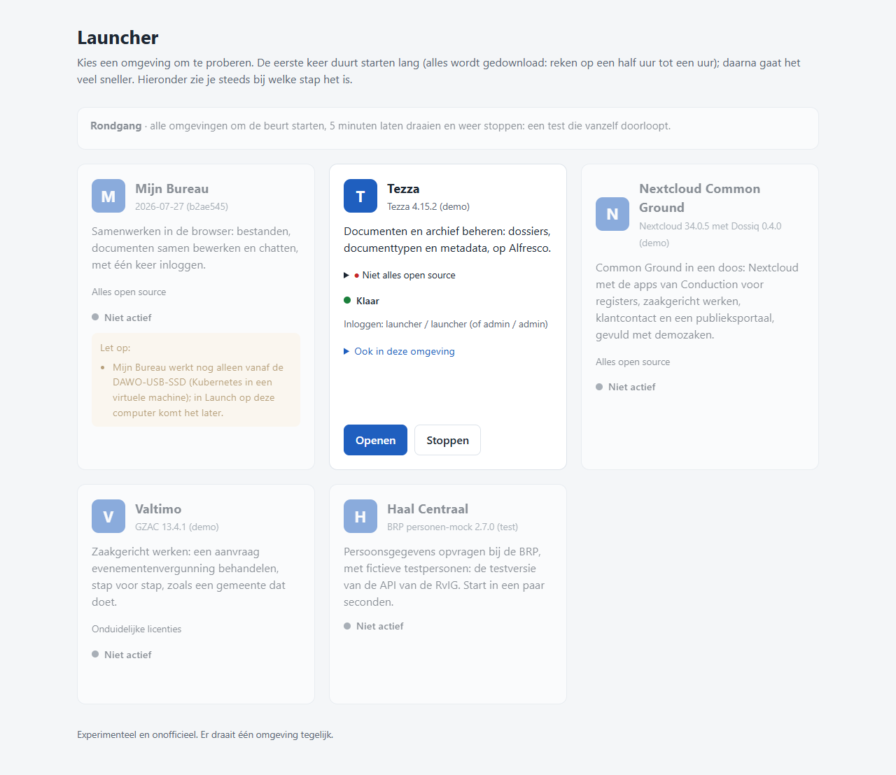

# Launch

Met de **Launcher** start, stop en open je omgevingen op je eigen computer, één tegelijk. Een omgeving is een complete applicatie die je wilt laten zien of uitproberen. Nu zijn dat:

| Omgeving | Wat het is | Eerste start |
|---|---|---|
| **Mijn Bureau** | Bestanden, samen documenten bewerken en chat, met één inlog. **Werkt nog alleen vanaf de DAWO-USB-SSD**: het draait op Kubernetes. De kaart staat er wel, met die melding. | – |
| **Tezza** | Het zaak- en documentbeheer van Contezza, compleet zoals Contezza het levert (tezza-packaging 4.15.2: Alfresco, GZAC, Open Zaak, Notificaties, Objecten), met de zaaktypes van Súdwest-Fryslân. | ongeveer 45 minuten (ongeveer 8 GB downloaden), daarna een paar minuten |
| **Nextcloud Common Ground** | De apps van Conduction (Dossiq, Pipelinq, Portaliq, OpenRegister) in Nextcloud, met demozaken. | ongeveer 20 minuten |
| **Valtimo** | Zaakgericht werken (GZAC): een aanvraag evenementenvergunning behandelen, met Open Zaak, Objecten en een burgerformulier (Open Formulieren). | ongeveer 30 minuten |
| **Haal Centraal** | Persoonsgegevens opvragen bij de BRP-testversie van de RvIG, met fictieve testpersonen. Klein en snel: handig om de Launcher te leren kennen. | een minuut |

Launch is een **experimenteel en onofficieel** project. Het is geen product van Contezza, Conduction, Ritense, de RvIG, Mijn Bureau of een gemeente. Het komt voort uit [dawo-appliance](https://github.com/EduardWitteveen/dawo-appliance) en werkt ook los daarvan.

## Installeren (Windows 10/11)

1. Download **[Launch-installeren.cmd](https://github.com/EduardWitteveen/launch/releases/download/v0.1.0-rc.4/Launch-installeren.cmd)**.
2. Dubbelklik erop. Windows waarschuwt misschien ("Windows heeft uw pc beveiligd"). Kies dan *Meer informatie* → *Toch uitvoeren*.
3. Het bestand zet alles neer wat nodig is en slaat over wat er al is:
   - **Git for Windows** en **Python 3**;
   - **Docker**: is Docker Desktop er al, dan gebruikt het dat. Anders installeert het **Rancher Desktop** (gratis en open source). Kies bij de eerste start van Rancher Desktop voor *dockerd (moby)* en zet *Kubernetes* uit;
   - Launch zelf in `%LOCALAPPDATA%\Programs\Launch`;
   - een snelkoppeling **Launcher** in het Startmenu en op het bureaublad;
   - de hostnaam `identity` in het hosts-bestand. Die is nodig om in te loggen bij Tezza. Windows vraagt hiervoor één keer om beheerdersrechten.
4. Daarna gaat de Launcher open in je browser: <http://localhost:1900/>.

Is er net Git, Python of Rancher Desktop bijgekomen en doet de Launcher niets? Herstart dan de computer en open **Launcher** opnieuw.

## Installeren (macOS, Apple Silicon)

Er is nog geen installer voor macOS; de Launcher start je handmatig.

1. **Docker Desktop**: download en installeer het van [docker.com](https://www.docker.com/products/docker-desktop/) en start het. Geef het daarna voldoende geheugen: **Settings → Resources → Memory**, zie "Wat je computer nodig heeft" hieronder.
2. **Python 3** en **Git**: op een recente macOS staan die er meestal al (`python3 --version`, `git --version` in Terminal); zo niet, installeer ze bijvoorbeeld met [Homebrew](https://brew.sh) (`brew install python git`) of met Xcode's command line tools (`xcode-select --install`).
3. Clone deze repository: `git clone https://github.com/EduardWitteveen/launch.git && cd launch`.
4. Start de Launcher: `python3 launcher/launcher.py`.
5. Open <http://localhost:1900/> in je browser.

**AMD64 op Apple Silicon**: de meeste images van Tezza zijn er alleen voor `amd64`; Docker Desktop draait die op een ARM64-Mac onder emulatie (Rosetta of QEMU, naar wat in Docker Desktop staat ingesteld). Dat werkt, maar is trager dan op een Intel-computer en downloadt meer de eerste keer. Gaf een container een ELF- of architectuurfout (`exec format error`, `rosetta error`, `Invalid ELF image`), dan meldt de Launcher dat specifiek; het helpt vaak om de image opnieuw te downloaden (zie "Als het niet lukt").

**De hostnaam `identity`** (nodig om bij Tezza in te loggen, Keycloak draait op `http://identity:8181`): de Launcher lost dit net als op Windows zelf op (`tools/hostnamen.sh`, met een GUI-wachtwoordvraag via macOS zelf), door `127.0.0.1 identity` toe te voegen aan `/etc/hosts` (met een kopie van het oude bestand in `/etc/hosts.bak-launch`). Met de hand: `sudo sh -c 'echo "127.0.0.1 identity" >> /etc/hosts'`.

**Logbestanden**: `~/.local/state/launch/<omgeving>.log` (en `LAUNCH_STATE` om een andere map te gebruiken).

Dit pad (handmatig starten met Python) werkt ook op Linux, zonder iets macOS-specifieks: Docker Desktop vervang je door `docker` en `docker compose` uit de pakketbeheerder, en de `identity`-fix gebruikt hetzelfde `tools/hostnamen.sh` (met `pkexec`, of anders `sudo` in de terminal die de Launcher start). Dat laatste is experimenteel: of het zonder iets te vragen werkt, hangt af van wat er op dat Linux-systeem aan polkit of sudo is ingesteld.

## Gebruiken

- Open **Launcher** (Startmenu of bureaublad). Docker en de Launcher starten vanzelf als ze nog niet draaien.
- Klik bij een omgeving op **Starten**. De kaart laat zien welke stap bezig is en hoe lang het nog ongeveer duurt. Een omgeving haalt bij de eerste start zelf alles op wat ze nodig heeft.
- Is hij klaar, dan klik je op **Openen**. Met **Stoppen** zet je hem weer uit.
- Er draait één omgeving tegelijk. Zolang er een actief is, zijn de andere grijs.
- **Rondgang**: de Launcher start alle omgevingen om de beurt, laat ze een tijdje aan staan en gaat door naar de volgende. Zo zie je zonder op te letten of alles nog werkt. Je zet hem uit met *Rondgang stoppen*.

**Tezza:** log in met `launcher` / `launcher`. Dat is een demo-gebruiker met dezelfde groepen als de beheerder. Er staan vijf fictieve demozaken klaar, bij de zaaktypes Omgevingsvergunning, Evenementenvergunning en Bezwaarschrift van Súdwest-Fryslân, met een status, een aanvrager (testpersonen uit Haal Centraal) en documenten.
## Wat je computer nodig heeft

- Windows 10 of 11, 64-bit, met beheerdersrechten voor de installatie.
- **Geheugen**: Tezza heeft ongeveer 16 GB nodig binnen Docker (Alfresco is bij minder in de praktijk door geheugentekort gestopt, "OOMKilled"). Docker (WSL) krijgt standaard de helft van het geheugen van de computer. Met 32 GB werkt het dus vanzelf. Met 16 of 18 GB moet je Docker meer geven: zet in `%USERPROFILE%\.wslconfig` onder `[wsl2]` de regel `memory=16GB` en herstart de computer. De Launcher waarschuwt op de kaart als het te weinig is (en zegt, als een container daardoor is gestopt, welke en met welke foutcode).
- Schijfruimte: ongeveer 20 GB voor Tezza.
- Internet bij de eerste start.
- **Licentie Docker Desktop**: in een organisatie met meer dan 250 medewerkers of meer dan 10 miljoen euro omzet is Docker Desktop niet gratis. Rancher Desktop is wel altijd gratis. Daarom installeert Launch Rancher Desktop als er nog geen Docker is.

## Als het niet lukt

- De kaart zegt **Starten mislukt**: klik op **Opnieuw proberen**. De details staan in `%LOCALAPPDATA%\launch\<omgeving>.log` (macOS/Linux: `~/.local/state/launch/<omgeving>.log`).
- **Docker draait niet**: start Docker Desktop of Rancher Desktop en wacht tot het klaar is.
- **Te weinig geheugen**: de kaart waarschuwt hiervoor voordat je start, en zegt (als het zover kwam) welke container daardoor is gestopt (OOMKilled) en met welke exitcode. Geef Docker meer geheugen (zie "Wat je computer nodig heeft") en probeer opnieuw; bestaande volumes en gegevens blijven gewoon staan.
- **Een container start niet** (gebruiker ontbreekt in de image, of een `amd64`-image werkt niet onder emulatie op Apple Silicon): de kaart noemt de container en wat docker zelf erover meldt. Vaak helpt het de image gericht opnieuw te downloaden, bijvoorbeeld `docker pull --platform linux/amd64 <image>`; Launch verwijdert zelf nooit een image, container of volume.
- **"identity" onbekend** (Tezza): dat lost de Launcher zelf op. **Starten** (of **Nu oplossen** op de kaart) voegt de naam toe; op Windows vraagt dat eenmalig om toestemming (UAC), op macOS een wachtwoordvraag van macOS zelf. Met de hand kan het ook: `tools\hostnamen.cmd` in `%LOCALAPPDATA%\Programs\Launch` (Windows) of `tools/hostnamen.sh` (macOS/Linux).
- **Opnieuw installeren**: voer `Launch-installeren.cmd` nog eens uit. Wat al gedownload is (Docker-images, de gegevens van Tezza) blijft bewaard.

## For developers

- `launch.py` is the command line (`python launch.py --list | --status | <id> | --stop <id> | --check <id>`), with the same JSON contract as DAWO's `launch` (`--list --json` gives `{"schema": 1, "environments": [...]}`).
- `launcher/` is the Launcher: `launcher.py` (a small HTTP server on 127.0.0.1) and `launcher.html`. Its behaviour is specified in dawo-appliance's `docs/launcher-behaviour.md`.
- Known problems and their fixes are in an environment's `environment.json` under `checks`: how to see the problem (`when`: `host_unknown` or a `command` that fails), the text for the person (`problem`), and optionally a `fix` (`text` = what it changes, shown before it runs; `run` = one command per OS it works on, `{"windows": [...], "macos": [...], "linux": [...]}` - an OS missing there has no automatic fix). A start runs the fixes first and the Launcher shows **Nu oplossen**; `launch.py --fix <id>` runs them alone. The format is described in `launch.py`.
- Before a start Launch also checks the ports the environment's addresses use on `localhost` (and `needs.ports`): one held by another program, or by a container that is not one of Launch's environments, is a problem on the card.
- `launch.py`'s `check()` also looks at the environment's own containers (`project_containers()` / `container_problem()`): a container that is there but not running becomes a problem on the card, worded from docker's own state (`OOMKilled`, the exit code, or a known cause - a missing container user, an image that will not run under emulation) rather than a generic "could not connect". This runs whether or not the environment currently answers, so a container that is silently stuck while everything else keeps working still shows up.
- `docker_memory_gib()` is what Docker itself can give containers (its VM's budget on Windows/macOS, the host's own memory on Linux); `host_memory_gib()` is the computer's physical memory, used only to explain *why* Docker's budget might be low. `needs.memory_gib` per environment is a lower bound, evidence-based rather than a round number: Tezza's came from a real run that was OOM-killed around 11.7 GiB and worked at 17.5 GiB.
- An environment is a directory under `environments/` with `environment.json` (what the card shows, `health`, `needs`, `checks`, and `project`: the compose project of its containers; it is only "klaar" when those run, not when something else answers on its address) and `run.sh start <progress-file> | stop`, run with Git for Windows' bash on Windows, plain bash on macOS/Linux. Every image is pinned by digest and every source by commit.
- State lives in `%LOCALAPPDATA%\launch` (or `LAUNCH_STATE`; `~/.local/state/launch` on macOS/Linux).
- Browser test: `cd tests/e2e && npm install && node launcher-behaviour.js "%LOCALAPPDATA%/launch" http://localhost:1900/` (uses Chrome via playwright-core, and starts Haal Centraal for real).
- Unit tests for `launch.py` (mocked `docker`, no real Docker or download needed): `python3 -m unittest tests/test_launch.py`.

## Licentie

EUPL-1.2 (zie `LICENSE`). De omgevingen hebben hun eigen licenties; die staan op de kaart in de Launcher.
